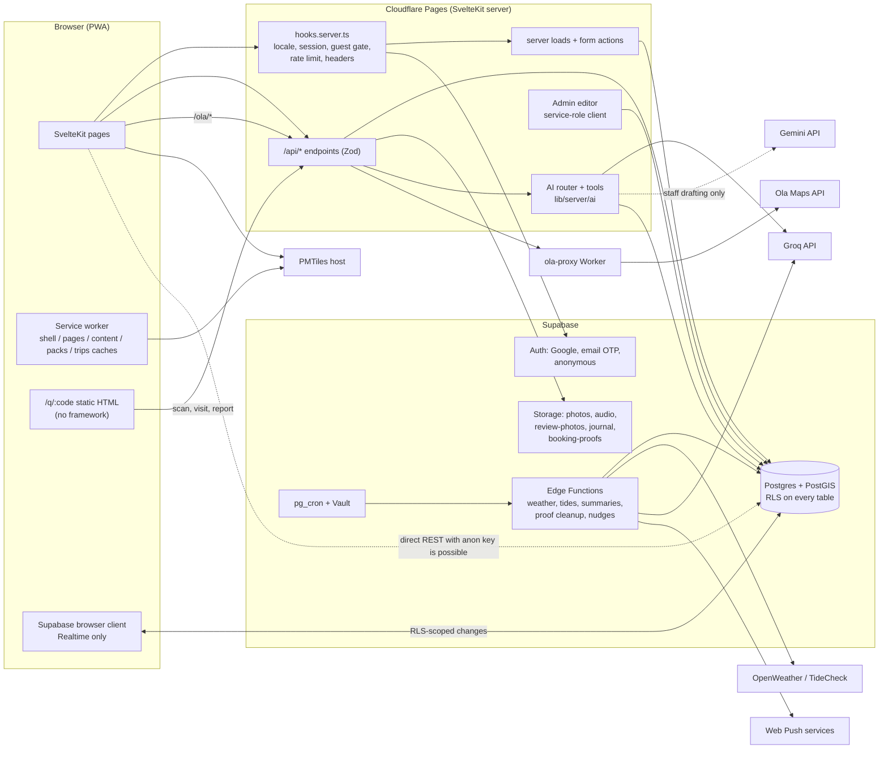

# Crabwalk — Architecture (survey of 2026-11-12)

Read-only survey of `main` @ `4ab460b` plus the uncommitted working tree. Every statement cites a file I read or a command I ran. "Unverified" marks anything I could not confirm from the repo (mainly the state of the hosted Supabase and Cloudflare dashboards, which I did not touch).

Companion files: `SECURITY_AUDIT.md`, `UI_AUDIT.md`, `UX_AUDIT.md`, `AI_AUDIT.md`, `OPUS_IMPLEMENTATION_PROMPT.md`.

## Assumptions

1. **Report location.** The request named the files but not a folder. They are in `docs/audit/`.
2. **Phase 6 has no named file.** Its content (feature ideas, code quality, roadmap) is Part B of this file.
3. **"Emotion / genre / hygiene / authenticity" ratings.** The code has no dimensions called emotion or genre. It has a 4-level verdict per traveller group (`verdicts.level` 1–4 × `group_type`, `supabase/migrations/20261017100400_ratings_qr.sql:4-14`) and sub-scores `taste, authenticity, hygiene, value, cleanliness, host, location` (`:17-19`). I treated "emotion" as the verdict level and "genre" as the traveller group / place category.
4. **"Stays sorted by vibe."** Vibe is a filter, not a sort (`apps/web/src/lib/server/filters.ts:13-20`, `apps/web/src/lib/sort.ts:3`). Sorts are `best`, `price_asc`, `price_desc`.
5. **Live state** is taken from `docs/DEPLOY_CHECKLIST.md` (dated 2026-11-06): temp gate on, anonymous sign-ins on, AI keys empty, no map tiles host, no edge functions deployed. Not re-checked against the live site.
6. **Project rules win over the survey brief** where they conflict (`CLAUDE.md`): ₹0 budget, no parallax (`CRABWALK_FRONTEND.md:299`), glass only over photos and the map (`apps/web/src/app.css:452`), no stock photos. Conflicts are called out where they arise.
7. **Branch rule.** The brief asks the implementation prompt to use a new git branch; the project memory says "main only". The implementation prompt follows the brief (branch) and flags the conflict in its manual-steps section.

---

# Part A — Architecture

## 1. Stack and versions

| Layer | Choice | Version (installed, from `pnpm -r outdated`) | Source |
|---|---|---|---|
| Framework | SvelteKit (Svelte 5 runes mode forced) | kit 3.1.0, svelte 5.57.2 | `apps/web/package.json`, `apps/web/vite.config.ts:58-63` |
| Build | Vite, TypeScript strict | vite 8.3.4, typescript 6.0.3 | `apps/web/package.json` |
| Styling | Tailwind CSS 4 via `@tailwindcss/vite`; default palette/radii/shadows removed | 4.3.3 | `apps/web/src/app.css:237-256` |
| i18n | Paraglide (cookie → Accept-Language → `en`); en / hi / mr | 2.29.0 | `apps/web/vite.config.ts:51-57`, `apps/web/messages/` |
| Hosting | Cloudflare Pages via `@sveltejs/adapter-cloudflare`; manual `wrangler pages deploy` from a laptop | adapter 8.0.1, wrangler 4.151.1 | `apps/web/wrangler.jsonc`, `docs/DEPLOY_CHECKLIST.md:68-74` |
| Data | Supabase: Postgres + PostGIS + pgvector + pg_cron + pg_net + pg_trgm, Auth, Storage, Realtime, Edge Functions | supabase-js 2.118.0, CLI 2.121.0 | `supabase/migrations/20261017100000_extensions_enums.sql:2-3`, `20261017200100_p3_context.sql:20-21` |
| Map | MapLibre GL + PMTiles (Protomaps basemap) | maplibre-gl 6.14.0, pmtiles 4.5.0 | `apps/web/package.json` |
| AI | Groq (traveller chat, vision), Gemini (staff drafting only), mock provider for tests | model ids from env | `apps/web/src/lib/server/ai/router.ts:27-51` |
| Validation | Zod 4 | ^4.6.7 | `apps/web/package.json` |
| Other runtime deps | `@lucide/svelte`, `svelte-dnd-action`, `uqr` (QR encode), `@protomaps/basemaps`, `@supabase/ssr` | — | `apps/web/package.json` |
| Tests | Vitest (28 unit files), pgTAP (21 files: 20 tracked + 1 untracked), Playwright + axe (14 suites, 84 tests) | vitest 4.1.12, playwright 1.64.1 | `find … *.test.ts`, `supabase/tests/`, `apps/web/e2e/` |
| Side service | `services/ola-proxy` Cloudflare Worker (`jose` for JWT verify) | jose 6.2.12 | `services/ola-proxy/src/handler.ts` |
| Offline pipelines | Node scripts + Docker (osmium, OSRM), `@huggingface/transformers` for embeddings | — | `pipelines/` |

Package manager: pnpm 10.32.1, Node ≥ 22 (`package.json`). Workspaces: `apps/*`, `services/*`, `pipelines` (`pnpm-workspace.yaml`).

**Documentation drift:** `README.md:58` says the fonts are "Eczar display + Anek body"; the code uses EB Garamond + Figtree with Anek Devanagari for the Devanagari range (`apps/web/src/app.css:199-234`).

## 2. Folder structure

```
apps/web/
  src/routes/            50 page routes, 83 +server.ts endpoints (71 under api/; the rest: q/, auth/, ola/, prefs, sitemap, robots)
  src/lib/components/    84 Svelte components (shell, cards, listing/, rating/, map/, plan/, crabby/, admin/)
  src/lib/server/        data access (listings, content, tables), auth, gate, rate, planner/, ai/, chat/
  src/lib/               client state (*.svelte.ts), helpers, db.types.ts (generated, 1,943 lines)
  src/service-worker/    index.ts (166 lines)
  src/hooks.server.ts    handle = shell → supabase → devAuth → guestGate → limits
  messages/              en.json, hi.json, mr.json (+ NEEDS_REVIEW.md)
  e2e/                   Playwright suites + screenshot baselines
  static/                fonts (3 woff2), icons, 11 category images, manifest.webmanifest
services/ola-proxy/      Worker: /ola/autocomplete, /ola/directions
supabase/
  migrations/            37 files (36 tracked + 1 untracked: 20261111100000_auto_entry_codes.sql)
  functions/             5 cron functions + _shared
  tests/                 pgTAP
pipelines/               osm-extract, tiles, road-flags, osrm-matrix, utility-pois, trails, tide-stations,
                         embeddings, content-import, seed-cleanup
data/                    desk-research YAML per taluka (places, stays, eateries, dishes, events)
docs/                    DECISIONS.md, DEPLOY*.md, RESTORE_AUTH.md, design brief, reports
scripts/                 AI-firewall check, env guard, DB backup
```

## 3. Data flow



The dotted line at the bottom matters for security: the Supabase URL and anon key are public env vars (`apps/web/src/env.ts:7-8`), so anything RLS allows can be done directly against PostgREST, skipping the SvelteKit server's Zod validation and rate limits. See `SECURITY_AUDIT.md` SEC-05.

## 4. Request pipeline

`apps/web/src/hooks.server.ts:79` — `sequence(shell, supabase, devAuth, guestGate, limits)`:

1. **shell** (`:45-53`): Paraglide locale; theme cookie → `data-theme` attribute in the HTML.
2. **supabase** (`:16-42`): `createServerClient` with the anon key and request cookies; `locals.getUser()` validates the JWT with the auth server, memoised per request.
3. **devAuth** (`apps/web/src/lib/devAuth.server.ts:59-88`): dev-only mock user. Guarded by `dev && !import.meta.env.PROD && DEV_BYPASS_AUTH === 'true' && localhost` (`apps/web/src/lib/devAuth.ts:11-15`).
4. **guestGate** (`apps/web/src/lib/server/guest.ts:12-37`): when `AUTH_MODE=temp_email_gate`, a visitor with no session gets a Supabase anonymous session on the first HTML GET (bots excluded by user-agent). A temp-admin session whose signed cookie is missing or invalid is signed out.
5. **limits** (`hooks.server.ts:56-77`): per-client fixed-window rate limit for the write routes listed in `apps/web/src/lib/server/rate.ts:17-78`, then security headers.

Roles: `session()` reads `user_roles` (full mode) or grants all staff roles from the signed admin cookie (temp mode) — `apps/web/src/lib/server/auth.ts:25-51`.

## 5. Features → files → data

| Feature | Entry points | Server code | Reads | Writes |
|---|---|---|---|---|
| Discover (home) | `routes/+page.svelte`, `+page.server.ts` | `lib/server/listings.ts`, `ratings.ts`, `planner/itineraries.ts` | places, translations, photos, verdict_agg_all, weather_cache, tide_cache, events_calendar, trips (ready-made) | — |
| Place guide | `routes/place/[slug]` | `listings.ts`, `ratings.ts` | places, place_translations, place_hours, place_seasonal, crowd_typical, audio_guides, photos, reviews, review_summaries | verdicts, reviews (via API) |
| Stays | `routes/stays`, `routes/stays/[slug]` | `listings.ts`, `filters.ts`, `sort.ts`, `prices.ts` | stays, stay_translations, stay_offers, verdict_agg_all, `sub_score_summary()` | verdicts, sub_scores, reviews, booking_proofs, stay_requests |
| Food / Taste Konkan | `routes/food`, `routes/taste-konkan` | `listings.ts` | eateries, eatery_hours, eatery_dishes, dishes, dish_translations | verdicts, sub_scores, reviews |
| Ratings | `lib/components/rating/*`, `/api/verdicts`, `/api/subscores`, `/api/reviews`, `/api/booking-proofs` | `lib/server/ratings.ts`, `review.ts` | verdict_agg, verified_visits | verdicts → trigger refreshes `verdict_agg` (`20261019100000_p5_ratings.sql:21-62`); sub_scores; reviews (`pending`); review_photos + `review-photos` bucket; booking_proofs + private bucket |
| Map | `routes/map`, `lib/components/map/MapView.svelte` (973 lines) | `/api/map/*`, `lib/server/map.ts` | RPCs `map_pins`, `map_utilities`, `map_search`, `map_heatmap`, `map_alerts`, `map_trails`; tide_cache | — |
| Offline packs | `lib/components/OfflinePacks.svelte`, `lib/packs.ts` | `/api/packs`, `lib/server/packs.ts` | talukas.pack_url, tiles manifest | Cache Storage `packs-v1` |
| Trip planner | `routes/plan/new`, `routes/plan/[id]` (939 lines) | `lib/server/planner/{trips,workspace,data}.ts`, `lib/planner/engine.ts` (deterministic) | places, hours, seasonal, tide rules, travel_matrix, correction_factors, alerts, weather | trips, trip_stops, trip_budget, trip_lists, trip_notes, trip_expenses, trip_members, trip_invites |
| Group chat | `lib/components/plan/TripChat.svelte`, `/api/trips/[id]/chat` | `lib/server/chat/trip-chat.ts`, `ai/group.ts` | trip_messages (Realtime), trip_poll_votes | `post_trip_message()` (HMAC-signed, `20261104100000_p12_crabby.sql:348-390`) |
| Live trip / navigation | `routes/trip/live/[id]`, `routes/navigate` (prerendered) | `/api/trips/[id]/routes`, RPC `nav_leg` | travel_matrix shapes + turn cues | dwell_events (with consent), push_subscriptions |
| Crabby (AI) | `routes/crabby`, `lib/components/crabby/*`, `/api/ai/*` | `lib/server/ai/*` | via tools: places, stays, eateries, dishes, tide/weather cache, the user's trips, team answers | ai_usage, ai_feature_usage, ai_actions, team_questions, ai_leads, user_profile |
| QR | `routes/q/[code]` (+ `scan`, `visit`, `report`), `routes/admin/qr` | `lib/server/qr.ts`, `lib/qr/page.ts` | qr_codes, listing data, `qr_near_me()` | qr_scans via `qr_record_scan()`, verified_visits via `qr_verify_visit()`, reports |
| Booking | `lib/components/listing/PriceTable.svelte` | `lib/server/prices.ts`, `agoda.ts` (stub) | stays.price_*, stay_offers.deep_link | none. Links are plain external anchors; there is no redirect endpoint and no click logging. |
| Availability requests | `lib/components/RequestForm.svelte`, `routes/me/requests`, `routes/owner/requests` | `lib/server/requests.ts` | stay_requests | stay_requests, push_queue |
| Saved | `lib/saved.svelte.ts`, `/api/saved` | — | saved_items | saved_items |
| Journal / trip report | `routes/plan/[id]/journal`, `…/report`, `routes/journal/[token]`, `routes/plan/share/[token]` | `lib/server/journal.ts`, `report.ts` | trip_journals, journal_photos, trip_reports | same + `journal` bucket |
| Owner tools | `routes/owner/*`, `/api/owner/*` | `lib/server/owner.ts` | own stays/eateries | fact fields only (trigger `guard_owner_*`, `20261017100200_listings.sql:338-362`) |
| Admin / field team | `routes/admin/*` (18 pages), `/api/admin/*` | `lib/server/content.ts` (1,010 lines), `tables.ts`, `admin.ts` | everything | `admin_apply_save()` with the service role |
| SEO | `lib/components/Meta.svelte`, `routes/sitemap.xml`, `routes/robots.txt` | `lib/seo.ts` | published slugs | — |

## 6. Data model and access

All 91 tables have RLS enabled (checked: the set of `create table` names equals the set of `enable row level security` names across `supabase/migrations/*.sql`). Helper predicates live in a non-exposed `app` schema (`20261017100000_extensions_enums.sql:18-19`).

Legend: **anon** = no session; **user** = any Supabase session, including anonymous guest sessions; **staff** = verifier / reviewer / admin via `user_roles`; **svc** = service role only.

| Group | Tables | Read | Write |
|---|---|---|---|
| Geography | regions, talukas | anyone | admin |
| Identity | profiles | own (+admin) | own update (all columns) |
| | user_roles | own (+admin) | admin; `review_owner_claim()`; service role in temp-gate mode |
| | user_preferences, consents, user_profile | own | own |
| Listings | places, stays, eateries (+ translations, hours, seasonal, crowd_typical, audio_guides, eatery_dishes, stay_offers, photos) | published rows: anyone; drafts: staff for that taluka | staff; owners limited to fact columns by trigger; publish only by reviewer/admin (`guard_publish`) |
| | dishes, dish_translations | published | reviewer/admin |
| | listing_team, listing_private, listing_form, gate_attempts | svc | svc |
| | content_drafts, verifier_notes, place_tide_rules, import_audit, road_segments_flags | staff | staff / admin |
| | owner_claims | own (+admin) | own insert (`pending`); admin decides |
| Context | matrix_points, travel_matrix, correction_factors, weather_*, tide_*, alert_type_ttl, app_config, trails, utility_pois, category_visit_minutes, route_stats | anyone | admin (alerts, utility_pois: staff; events_calendar: reviewer; events read only when `published`) |
| Ratings | verdicts, sub_scores | own (+admin) | own; owners of the listing excluded; hygiene/cleanliness need a verified visit |
| | verdict_agg, verdict_agg_all, review_summaries | anyone | trigger / edge function |
| | reviews | approved: anyone; own; reviewers | own insert as `pending`; own update resets to `pending`; reviewers moderate |
| | review_photos | follows the review | own |
| | verified_visits | own (+admin) | only via `qr_verify_visit()` / `review_booking_proof()` |
| | booking_proofs | own + staff | own insert; staff review |
| QR | qr_codes | anyone | admin via `create_qr_code()`; delete revoked |
| | qr_scans | none | only via `qr_record_scan()` (executable by anon) |
| | sponsors | anon: `id, name` only | admin |
| | reports | staff | **anyone may insert** (`status='new'`) |
| Trips | trips | owner, members, ready-made or approved routes: anyone | owner (all columns); members via workspace tables |
| | trip_stops, trip_budget, trip_lists, trip_list_items, trip_notes, trip_expenses, trip_expense_shares | members | editors |
| | trip_members, trip_invites | members / owner | owner; editors add name-only members; `redeem_trip_invite()`, `add_trip_member_by_email()` |
| | trip_messages, trip_poll_votes | members | only via `post_trip_message()`; own vote |
| | trip_reports, trip_journals, journal_photos | members / own; public by token RPC | editors / own |
| | published_routes | approved: anyone; owner; reviewers | owner submits; reviewer decides |
| | group_votes | trip owner | none (RPC revoked in `20261104130000_p12_group_chat.sql:29`) |
| Activity | dwell_events | admin | user with a `dwell_time` consent row |
| | user_activity | own | own, when `use_activity` is on |
| | saved_items | own | own |
| AI | ai_usage, ai_feature_usage | own | only via `ai_take_message()`, `ai_take()` |
| | ai_actions | own | own insert as `proposed`; own decide |
| | team_questions | asker + team | asker insert (5/day trigger); team answers |
| | stay_requests | traveller, listing owner, team if unclaimed | guarded by `guard_stay_request` state machine |
| | ai_leads, crabby_group_usage | team / members | own insert / RPC |
| Infra | rate_hits | none | only via `rate_take()` (executable by anon) |
| | push_subscriptions | own | own, with a `push` consent row |
| | push_queue | svc | triggers |

**Storage buckets:** `photos` (public, WebP ≤ 3 MB), `audio` (public, staff only), `review-photos` (public, WebP ≤ 3 MB, write under `<uid>/`), `journal` (public, WebP ≤ 400 KB, write under `<uid>/`), `booking-proofs` (private, ≤ 5 MB). Sources: `20261018100000_p4_content.sql:21-51`, `20261019100000_p5_ratings.sql:115-137`, `20261104100000_p12_crabby.sql:499-505`.

**Cron:** weather hourly, tides daily, review summaries nightly, booking-proof cleanup nightly, trip nudges every 5 min, pattern refresh nightly, message purge nightly, year-ago push daily. Edge functions are called through `app.invoke_edge()` with a Vault secret (`20261017200100_p3_context.sql:26-43`).

## 7. External services and keys

| Service | Used for | Key (name only) | Where it lives |
|---|---|---|---|
| Supabase | DB, Auth, Storage, Realtime | `SUPABASE_URL`, `SUPABASE_ANON_KEY` (public); `SUPABASE_SERVICE_ROLE_KEY` (server) | Pages secrets; `apps/web/src/env.ts` |
| Supabase CLI | migrations, backups | `SUPABASE_DB_PASSWORD`, `SUPABASE_ACCESS_TOKEN` | repo-root `.env` on the laptop only (git-ignored) |
| Google OAuth | sign-in | `SUPABASE_AUTH_EXTERNAL_GOOGLE_CLIENT_ID/SECRET` | Supabase Auth config |
| SMTP | email OTP | `SMTP_*` | Supabase Auth config (empty locally) |
| Groq | Crabby, moderation, vision, review summaries | `GROQ_API_KEY` | Pages secret + edge function secret. **Empty on the live site** (`docs/DEPLOY_CHECKLIST.md:85`) |
| Gemini | staff content drafting | `GEMINI_API_KEY` | Pages secret (empty) |
| Ola Maps | address search, directions | `OLA_API_KEY` | only in the `ola-proxy` Worker (not deployed yet) |
| OpenWeather, TideCheck | weather and tide cache | `OPENWEATHER_API_KEY`, `TIDECHECK_API_KEY` | edge function secrets (not deployed yet) |
| Web Push | trip nudges | `VAPID_PUBLIC_KEY` (public), `VAPID_PRIVATE_KEY`, `VAPID_SUBJECT` | Pages + edge function secrets |
| Agoda | live prices | `AGODA_*` | adapter is a stub returning `null` (`apps/web/src/lib/server/agoda.ts:7-11`) |
| YouTube oEmbed | reel title lookup | none | `apps/web/src/lib/server/ai/reel.ts:49-55` |
| Internal secrets | rate-limit HMAC, group-chat signing, admin cookie, admin passcode, cron auth | `RATE_LIMIT_SALT`, `CRABBY_SIGNING_KEY` (= Vault `crabby_key`), `ADMIN_SESSION_SECRET`, `ADMIN_PASSCODE`, `ADMIN_EMAILS`, `CRON_SECRET` | Pages secrets / Vault |

No secret has ever been committed: `git log --all --diff-filter=A --name-only` shows only `.env.example` among env-like files, and pattern scans for JWTs, Groq, Google and Supabase secret keys across the tree and history returned nothing.

## 8. Offline and PWA behaviour

Source: `apps/web/src/service-worker/index.ts`.

| Cache | Contents | Strategy | Eviction |
|---|---|---|---|
| `shell-<version>` | build output, static assets, prerendered pages, `/_app/env.js` | precache on install, cache-first by pathname | replaced on each deploy |
| `pages-v1` | every successful same-origin navigation | network-first, falls back to the cached page, then `/`, then a plain "Offline" 503 | **never** |
| `content-v1` | `GET /api/{places,stays,eateries,dishes,map/utilities}` | stale-while-revalidate | **never** |
| `packs-v1` | downloaded `.pmtiles` and `/api/packs/:id/data` | cache-first with Range support | never (by design) |
| `trips-v1` | `/api/trips/:id/routes` | network-first with fallback | **never** |

Not cached: non-GET, other origins, and the prefixes `/auth /login /prefs /admin /owner /ola /api/admin /api/owner /api/saved` (`:18-29`).

Consequences found:

- `/me`, `/plan/:id`, `/trip/live/:id`, `/me/requests`, share-token pages and `/crabby` are **not** in the exclusion list, so their HTML is stored in `pages-v1` and stays after sign-out (SEC-09).
- Offline writes are queued only for the field team (`apps/web/src/lib/field/queue.ts`) and trip edits (`apps/web/src/lib/tripSync.svelte.ts`). Votes, reviews, saves and Crabby fail with a toast.
- Map pins and tides are deliberately network-only online; offline pins come from the pack data (`apps/web/src/lib/components/map/MapView.svelte:538`).
- The QR page is standalone HTML with no service-worker dependency (`apps/web/src/lib/qr/page.ts`).
- Manifest: `display: standalone`, four icons, no `shortcuts`, `screenshots` or `share_target` (`apps/web/static/manifest.webmanifest`).

## 9. Design system inventory ("Tideline")

Source: `apps/web/src/app.css`.

- **Colour tokens** (light `:6-66`, dark `:76-173`, both checked by `apps/web/src/lib/contrast.test.ts`): `bg, surface, surface-2, surface-3, border, border-strong, text, text-2, text-muted`; action `kokum` (#0270ae, a sky blue despite the name) with `hover/ink/50/100/on`; information `lagoon`; delight `alphonso` (fill only); `laterite`; status `ok, caution, danger`; `emergency` (emergency card and QR 112 bar only); verdict ramp `v1–v4`; `focus`, `scrim`, `glass`.
- **Legacy aliases** still mapped (`:174-192`, `:303-319`): `cta, link, highlight, sakura, asagi, yama, wakaba, fuji` — the comment says they were to be removed "at the end of step E".
- **Type:** EB Garamond 400 (display), Figtree variable 400–700 (text), Anek Devanagari for both in the Devanagari range. Utilities: `type-display-xl` 34/40 → 48/54, `type-display` 28/34 → 36/42, `type-h1` 24/30 → 28/34, `type-h2` 20/26, `type-h3` 17/24, `type-lead` 18/30, `type-body` 16/26, `type-body-strong`, `type-small` 14/20, `type-label` 13/16. Devanagari gets taller lines and no tracking.
- **Spacing:** Tailwind's default 4 px scale; no custom spacing tokens.
- **Radii:** `sm` 12, `md` 16, `lg` 24, `xl` 32, plus `full`.
- **Elevation:** `e1, e2, e3`; in dark mode a 1 px inner light edge replaces most of the shadow.
- **Breakpoints:** `sm` 640, `lg` 1024, `xl` 1280 (`md` and `2xl` removed).
- **Layers:** `z-map-ui` 10, `z-bar` 20, `z-panel` 30, `z-banner` 40, `z-overlay` 50.
- **Motion tokens:** `--ease: cubic-bezier(0.2, 0.8, 0.2, 1)`, `--dur-press` 120 ms, `--dur-state` 200 ms, `--dur-sheet` 320 ms, `--dur-shimmer` 1.2 s. Global reduced-motion rule collapses all animation and transition durations (`:531-540`).
- **Motion in use:** root cross-fade via View Transitions (`apps/web/src/routes/+layout.svelte:36-45`); button press scale .97; card hover lift and 1.03 photo zoom; skeleton shimmer; Crabby `sidestep` and `wave`; status-badge pulse; toast `fly`; scroll-timeline progress bar; bottom sheet animates `height`. No shared-element transitions, no scroll reveals, no count-ups, no rating feedback animation. No animation library.
- **Components:** shell (`Page, TopBar, AppNav, OfflineBanner, Toaster, LanguageSwitch`), primitives (`Button, IconButton, Chip, Segmented, Input, field` utility, `Skeleton, EmptyState, ErrorState, Illustration, NoPhoto, BottomSheet, Carousel, ScrollProgress, StatusBadge, TagList, InsetList`), cards (`ListingCard, PlaceCard, StayCard, EateryCard, HeroCard`), listing (`Hero, ActionBar, Facts, Hours, PriceTable, Contact, NearbyList, AudioGuide, ReportProblem`), rating (`VerdictGauge, MiniVerdict, SubScores, VerdictVote, Reviews`), map (`MapView, TideSlider, TideToday`), plan (12), crabby (7), admin (6). A gallery lives at `/dev/components`.
- **Graphics:** one mascot SVG (`Crabby.svelte`), three empty-state vignettes (`Illustration.svelte`), a wave mask on no-photo cards (`NoPhoto.svelte:57-63`), 11 category WebP tiles (`static/categories/`, credits in `CREDITS.md`), Lucide icons. No OG image generation: share cards use the listing photo or the app icon (`Meta.svelte:25`).

## 10. Tech debt, dead code, duplication, missing tests

| # | Item | Evidence |
|---|---|---|
| D1 | Temp access gate is live code across ~20 files, each marked `TODO(before-deploy)` | `git grep "TODO(before-deploy)"`; `docs/RESTORE_AUTH.md` |
| D2 | Legacy "Suna" colour aliases still defined and mapped | `apps/web/src/app.css:174-192, 303-319` |
| D3 | Dead tables / functions: `group_votes`, `cast_group_vote`, `trip_vote_counts` (grants revoked, objects kept) | `20261104130000_p12_group_chat.sql:29-30` |
| D4 | Agoda adapter is a stub that only logs a warning; `AFFILIATE_*` env vars unused | `apps/web/src/lib/server/agoda.ts`, `.env.example:42-43` |
| D5 | The phone/coordinate scrub regexes are duplicated between the web app and edge functions | `apps/web/src/lib/server/ai/scrub.ts:6-8`, `supabase/functions/_shared/groq.ts:3-4` |
| D6 | The same `TABLE` / `TR` / `HREF` lookup maps are redefined in at least five files | `routes/api/trips/[id]/chat/+server.ts:10-16`, `lib/server/qr.ts:65-70`, `lib/server/ai/tools.ts:372`, `routes/api/me/activity/+server.ts:6`, `lib/server/content.ts:65-72` |
| D7 | Very large single files: `lib/admin/fields.ts` 1,323, `lib/server/ai/tools.ts` 1,080, `lib/server/content.ts` 1,010, `MapView.svelte` 973, `routes/plan/[id]/+page.svelte` 939, `lib/server/planner/trips.ts` 769, `routes/admin/field/+page.svelte` 709 | `wc -l` |
| D8 | Admin editor uses an untyped Supabase client for dynamic table names | `apps/web/src/lib/server/content.ts:36-38`, `tables.ts:9-11` |
| D9 | Two pgTAP files fail on missing fixtures (pre-existing) | `docs/DEPLOY_CHECKLIST.md:49`, `:90` |
| D10 | README names the wrong fonts | `README.md:58` vs `app.css:199` |
| D11 | 13 empty commits at the tip of `main` | `git log --oneline -5` |
| D12 | 31 files modified and 2 untracked in the working tree, including a migration that is not committed | `git status` at session start |
| D13 | No Svelte component unit tests: the Vitest project excludes `*.svelte.test.*` and has only a `server` project | `apps/web/vite.config.ts:72-84` |
| D14 | No tests for the service worker, the rate limiter's allow/deny path (only rule matching, 23 lines), upload validation, or the AI prompt-injection paths | `lib/server/rate.test.ts`, absence of others |
| D15 | Screenshot baselines exist only for Windows and are skipped in CI | `.github/workflows/ci.yml:47-48` |
| D16 | No error tracking, no analytics, no uptime check | no matches for sentry / plausible / posthog / web-vitals in `apps/web/src` |

---

# Part B — Phase 6: code quality, features, roadmap

## B1. Code quality

| # | Problem | Why it matters | Change | Effort |
|---|---|---|---|---|
| Q1 | Two security boundaries with different rules: SvelteKit (Zod + rate limits) and PostgREST (RLS only). Several invariants exist only in the first. | Anything not enforced in SQL is not enforced. | Move every invariant into constraints, triggers or RPCs; treat the API layer as convenience. Details in `SECURITY_AUDIT.md`. | M |
| Q2 | `tools.ts` holds 15 tool definitions, their validation and their SQL in one 1,080-line switch. | Hard to test a tool in isolation or add evals per tool. | One file per tool exporting `{ def, schema, run }`; registry array; table-driven tests. | M |
| Q3 | `content.ts` + `fields.ts` (2,300 lines) hand-maintain a field catalogue that mirrors the schema. | Drift between the form, the validator and the DB. | Generate the catalogue from `db.types.ts` + a small overrides file; keep the DB-backed `admin_table_columns` path for generic tables. | L |
| Q4 | Errors are swallowed in many `.catch(() => {})` and `if (error) error(400)` paths without logging. | Failures in production are invisible. | A `log(event, level, fields)` helper writing structured JSON; call it at every swallowed error. | S |
| Q5 | The rate limiter fails open and lives in the same database it protects. | A DB incident removes the limiter exactly when it is needed. | Cloudflare rate-limit binding as the first layer (free on Workers/Pages), DB counter as the second. | M |
| Q6 | `invalidateAll()` after every vote tap reloads every loader on the page. | Slow feedback on weak networks; wasted reads. | Optimistic local state + `invalidate('app:ratings')` with a `depends` key. | S |
| Q7 | CI has no dependency audit, no bundle-size gate outside e2e, no Lighthouse run, actions pinned by tag. | Regressions and supply-chain drift go unnoticed. | Add `pnpm audit --prod`, a size check on the build output, SHA-pinned actions. | S |
| Q8 | Deploys are manual uploads from one laptop that also holds the DB password and a Supabase access token in plaintext. | Single point of failure and of compromise. | Git-connected Pages project with preview deployments protected by Cloudflare Access; secrets only in the dashboards. | M |
| Q9 | No generated types or tests for edge functions (Deno code is outside the workspaces). | Type drift against the schema. | Share `db.types.ts` with `supabase/functions` via an import map; add `deno check` to CI. | S |
| Q10 | Scaling: `review-summaries` loads up to 5,000 reviews into memory each night; `sitemap.xml` runs five queries per request with a 1-hour cache header only. | Fine now, degrades with data. | Incremental summaries keyed by `updated_at`; prerender or cache the sitemap in KV. | S |

## B2. Feature ideas (max 10)

| # | Idea | User value | Data needed | Effort | Risk | Builds on | Acceptance |
|---|---|---|---|---|---|---|---|
| F1 | **Visited stamps (passport).** A stamp per place after a verified QR + GPS visit; a shareable card of the coast with stamps filled in. | Reason to scan plaques and return; proof of having been there. | `verified_visits` (exists). | M | Spoofed GPS inflates stamps; depends on SEC-03. | `qr_verify_visit`, `routes/me` | A verified visit shows a stamp on Me within one page load; the share image contains no personal data beyond a chosen display name. |
| F2 | **Vibe search in plain words.** "quiet beach for sunset with kids" → ranked places with the reason for each. | Discovery without knowing names. | `place_embeddings` (exists), tags, crowd_typical. | M | Embedding quality in Marathi/Hindi. | `similar_places`, `pipelines/embeddings` | 20 fixed queries return at least one expected place in the top 3; every result shows which attributes matched. |
| F3 | **Monsoon mode.** A site-wide toggle (default on from June to September) that reorders lists by `place_seasonal`, shows closures first and swaps the home hero to monsoon-safe picks. | Safety and relevance in the region's defining season. | `place_seasonal`, `correction_factors` (exist). | S | Only 11 seasonal rows are loaded today (`DEPLOY_CHECKLIST.md:26`). | planner seasonal logic | With the toggle on, no place marked `closed` appears above an `open` one in any list. |
| F4 | **"Why locals go here" card.** One authored line per place from the field team, shown above the story. | The authenticity promise made concrete. | New nullable column on `place_translations`. | S | Content effort. | admin editor | The line is editable in the admin editor in three languages and hidden when empty. |
| F5 | **Hidden-gem crowd pledge.** For gems, show typical crowd per weekday and suggest the calmest slot; cap how many plans per day route to one gem. | Protects fragile spots; honest positioning. | `crowd_typical`, trip_stops counts. | M | Needs real crowd data; must not present guesses as live. | `less_crowded_alternatives`, heatmap | A gem with ≥ N planned visits on a date shows "busy that day" in the planner and offers an alternative. |
| F6 | **Dish trail.** Pick a dish (solkadhi, modak) → map of verified eateries serving it, as a ready-made half-day route. | Food-led discovery unique to the region. | `eatery_dishes` (exists). | S | Sparse eatery–dish links. | Taste Konkan pages, planner | A dish with ≥ 3 linked eateries shows a "Plan a food trail" button that creates a trip with those stops. |
| F7 | **Offline plan pack.** One tap on a trip downloads its pages, photos, routes and the needed taluka tiles. | The planner's promise holds with no signal on ghat roads. | Existing packs + trip routes cache. | M | Storage quota on low-end phones. | `packs.ts`, `tripSync`, `trips-v1` cache | In airplane mode, a downloaded trip opens with all stops, photos, the map and turn cues. |
| F8 | **Owner response on reviews.** A claimed owner can post one moderated reply per review. | Trust on both sides; a reason for owners to claim. | New `review_replies` table. | M | Moderation load; sponsorship must never affect placement (hard rule). | `owner_claims`, review moderation | Replies appear only after reviewer approval and never change sort order. |
| F9 | **Festival and season calendar.** A browsable month view of `events_calendar` linked to nearby places and stays. | Trip timing; a return trigger. | 41 events exist. | S | Dates must be maintained yearly. | Today strip, events admin | Each published event links to at least one place and can be added to a trip date. |
| F10 | **Plaque health for the team.** Scan counts per plaque, "broken QR" reports, and a list of plaques with no scans in 30 days. | Catches missing or vandalised plaques, including sticker swaps. | `qr_scans`, `reports` (exist). | S | Scan counts are forgeable until SEC-04 is fixed. | `routes/admin/qr` | The admin QR page lists each plaque with 7- and 30-day scan counts and flags zero-scan plaques. |

## B3. Roadmap

Flags: **[M]** DB migration · **[E]** new env var · **[D]** new dependency · **[YOU]** manual action by the owner.

### Tier 0 — security and breakage (do first, in this order)

| Order | Item | Flags | Depends on |
|---|---|---|---|
| 0.1 | Back up the hosted DB; rotate nothing yet | [YOU] | — |
| 0.2 | SEC-01: stop trip owners setting `is_ready_made` / `slug` | [M] | 0.1 |
| 0.3 | SEC-05: length constraints, per-user quotas, reports through an RPC | [M] | 0.1 |
| 0.4 | SEC-04 + SEC-06: revoke anon execute on `qr_record_scan` and `rate_take`; call them with the service client | [M] | 0.1 |
| 0.5 | SEC-02: Turnstile on anonymous sign-in; lower the anonymous rate limit | [E] [YOU] | Turnstile keys |
| 0.6 | SEC-03: ratings and verified visits require a non-anonymous account; scan token on QR pages | [M] | 0.5 |
| 0.7 | SEC-12: global AI budget, per-IP daily cap, kill switch | [M] | — (must land before Groq keys are added) |
| 0.8 | SEC-09, SEC-10, SEC-11: service-worker exclusions and sign-out purge; exact CSP hosts | — | — |
| 0.9 | SEC-07, SEC-15, SEC-20, SEC-16: email oracle, push endpoint allow-list, shared-trip field allow-list, upload sniffing | [M] | — |
| 0.10 | SEC-17: custom domain and `PUBLIC_ORIGIN` before any plaque is printed | [E] [YOU] | domain purchase decision (₹0 rule: ask first) |
| 0.11 | SEC-24, SEC-25: account deletion, privacy/terms, structured logs, alerts | [M] | — |
| 0.12 | Commit or discard the 31 modified files and the untracked migration; fix the two failing pgTAP fixtures | [YOU] | — |

### Tier 1 — UI, motion and UX wins

| Order | Item | Flags | Depends on |
|---|---|---|---|
| 1.1 | Motion tokens and utilities (`UI_AUDIT.md` §3) | — | — |
| 1.2 | Named view transitions: card → detail, tab cross-fades | — | 1.1 |
| 1.3 | Rating flow: optimistic taps, gauge fill and count-up, verified-visit moment | — | 1.1, Q6 |
| 1.4 | Bottom sheet on `transform`; skeleton on `transform`; glass budget | — | 1.1 |
| 1.5 | Home hero, section reveals, no-photo card textures, empty/error art | — | 1.1 |
| 1.6 | Crabby thinking state and streamed reply rendering | — | Tier 2.1 |
| 1.7 | OG share cards | [D] only if server-side rendering of images is chosen; otherwise none | — |
| 1.8 | UX fixes: vote without a page reload, offline write queue for votes and saves, booking click-out interstitial, search empty states | [M] for click logging | 0.x |
| 1.9 | First-party analytics events table and dashboard | [M] | 0.11 |

### Tier 2 — AI

| Order | Item | Flags |
|---|---|---|
| 2.1 | Streaming replies (SSE) and a single combined intent + moderation call | — |
| 2.2 | Structured output with schema validation and place-citation check | — |
| 2.3 | Eval set in CI against the mock and (manually) the live provider | — |
| 2.4 | Prompt-injection hardening for stored text; summary output validation | — |
| 2.5 | Response cache for anonymous-safe tool results; thumbs up/down | [M] |
| 2.6 | Vibe search (F2) | — |

### Tier 3 — features and code quality

F3, F4, F6, F9, F10 (small) → F1, F7 (medium) → F5, F8; Q2, Q3, Q7, Q8, Q9 alongside. F4 and F8 need **[M]**.
